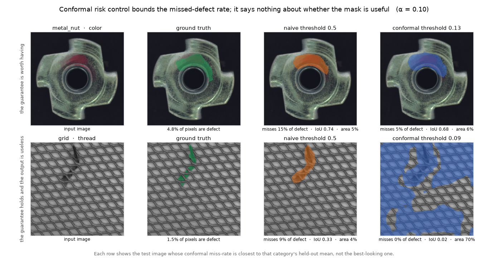

# defect-segmentation

[](https://github.com/mateus-aleixo/defect-segmentation/actions/workflows/ci.yml)


Industrial defect segmentation with a statistical guarantee on the masks. A torchvision
segmentation model is fine-tuned on MVTec AD defects, and its threshold is set with
conformal risk control, so that the predicted defect region misses at most α of the true
defect pixels on average (a pixel-level false-negative rate of at most α, in finite samples
and without distributional assumptions). The model is exported to ONNX with a parity
check, and inference runs without PyTorch, live on AWS Lambda (see [Serving](#serving)).



*Top row: a category where the method works. The calibrated mask is only slightly larger
and misses a third as many defect pixels. Bottom row: the same method on a category the
model never learned, where it keeps its 10% bound by covering most of the frame. Each row
shows the test image closest to that category's held-out mean, not the best-looking one.*

## Results

Full numbers are in [`docs/results.md`](docs/results.md).

Five categories, two losses, α = 0.10. The guarantee says nothing about the last column,
which is the one that decides whether the system could be deployed:

| category | validation IoU | false alarms, pixel loss | false alarms, instance loss |
|---|---|---|---|
| `tile` | 0.729 | 0.061 | 0.000 |
| `metal_nut` | 0.621 | 0.045 | 0.000 |
| `carpet` | 0.520 | 0.143 | 0.036 |
| `leather` | 0.393 | 0.344 | 0.062 |
| `grid` | 0.068 | 1.000 | 1.000 |

Every category where the model learned something improves with the instance loss, and two
of them have no false alarms at all. `leather` shows the problem most clearly: at its
pixel-loss operating point it escalates 34% of defect-free parts, which would not be
usable on a production line, and the conformal report alone would not have shown it (its
held-out false-negative rate is 0.063, well inside α). `grid` is the control. It does not
change, because the model has no signal to work with.

The naive and conformal thresholds compared in detail:

| | naive threshold of 0.5 | conformal threshold | false alarms on clean parts | summary |
|---|---|---|---|---|
| `metal_nut` | IoU 0.691, FNR 0.167 (misses the target) | IoU 0.644, FNR 0.055 (meets it) | from 0.000 to 0.045 (1 of 22) | the guarantee costs about 5 IoU points and one false alarm in 22, and fixes a 17% miss rate |
| `metal_nut`, instance loss | | instance FNR 0.025 (meets it) at λ̂ 0.290 | 0.000 (0 of 22) | bounding missed instances instead of missed pixels removes the false alarm |
| `grid` | IoU 0.184, FNR 0.385 (misses the target) | IoU 0.015, FNR 0.010 (meets it), mask area 0.81 | from 0.429 to 1.000 (21 of 21) | the guarantee holds only because every clean part is escalated, which makes it valid but useless |

`grid` is included on purpose. Conformal risk control guarantees validity, and it says
nothing about usefulness. A category where the model fails shows that difference most
clearly.

The last column comes from a defect-free control split. The conformal loss is the
fraction of true defect pixels that a mask misses, so a part with no defects adds zero
loss whatever the mask does. By construction, the guarantee cannot see how often a good
part is stopped. Scoring the same models on MVTec's untouched `test/good/` images measures
it. On `metal_nut` the guarantee costs almost nothing: one clean part in 22 is escalated.
On `grid` every clean part is escalated, so an oversized mask means the line would pass
nothing at all.


## Why put a guarantee on a mask

On an inspection line, the question is whether a part can ship without a person looking
at it. A raw sigmoid threshold cannot answer that, because 0.5 has no meaning when the
data shifts. Conformal risk control can. It picks the mask threshold

λ̂ = largest λ such that (n/(n+1)) · R̂(λ) + 1/(n+1) ≤ α

where R̂(λ) is the mean fraction of true defect pixels missed on a calibration split.
Under exchangeability, the deployed masks then miss at most α of defect pixels in
expectation. This is the worked example in Angelopoulos et al. (2022), implemented here
end to end: parts above the bar are passed automatically, and parts below it go to a
person. Automated visual inspection in general follows the same pattern: act only when
the model is provably reliable enough, and send the rest for review.

## Design

- **Data.** [MVTec AD](https://www.mvtec.com/company/research/datasets/mvtec-ad)
  (Bergmann et al., CVPR 2019), categories `metal_nut`, `tile`, `leather`, `carpet` and
  `grid`. MVTec AD is an anomaly-detection benchmark, so defect masks exist only in its
  test split. This repository therefore follows the supervised protocol and re-splits the
  mask-annotated images 60/20/20 into training, calibration and test sets. The resulting
  sample sizes are small, which is where a conformal guarantee is most useful, since it
  stays valid at small n. The dataset is licensed CC BY-NC-SA 4.0 (non-commercial research
  and portfolio use, attribution required, data never redistributed);
  `scripts/fetch_mvtec.py` downloads and extracts it.
- **Preprocessing.** OpenCV for decoding and resizing, Pillow for mask handling and
  augmentation (flips and rotations), deterministic under a seed.
- **Model.** torchvision `deeplabv3_mobilenet_v3_large` with a pretrained backbone and a
  1-channel defect head. The backbone is frozen by default, so fine-tuning fits on a CPU
  overnight, and one flag unfreezes it for training on a GPU.
- **Calibration.** `conformal.py` implements conformal risk control over a grid of
  thresholds, the curve of false-negative rate against λ, and held-out verification, with
  the finite-sample correction.
- **Control split.** `calibrate` also scores the defect-free `test/good/` images that the
  loss cannot see, and reports the false-alarm rate and the flagged area at both the naive
  and the conformal threshold. Without this number, a reported guarantee leaves out half
  of the picture.
- **Export and serving.** ONNX (opset 18) with a parity check that logs the maximum
  absolute difference, then a FastAPI service on onnxruntime, in one container image that
  runs unchanged locally and on Lambda. See below.
- **Tests and CI.** The test suite runs on synthetic fixtures (random ellipses as
  defects), with no dataset, no pretrained weights and no network access, so it is
  deterministic.

## Serving

The service returns a decision for each part (pass or escalate), together with the
numbers behind it. A mask is an intermediate result, and an inspection line acts on the
decision. Every response includes the guarantee and the false-alarm rate measured on the
control split, because the guarantee alone does not say whether the system is usable.

Live: `https://6s8ozlsit4.execute-api.eu-west-1.amazonaws.com`

```bash
curl https://6s8ozlsit4.execute-api.eu-west-1.amazonaws.com/models
```

The service is serverless, so the first request after an idle period waits for a cold
start, about 12 s here for a 520 MB image and a MobileNetV3 graph. Warm requests take
about 0.45 s. Throughput is limited to 5 requests per second.

Both categories are published, including the one that does not work. `/models` returns
`metal_nut` with a false-alarm rate of 0.045 next to `grid` at 1.000, so the main finding
of this repository can be checked with one request.

The same image can also run locally:

```bash
python -m conformal_seg.registry --run metal_nut   # build the registry first
docker compose up --build
curl localhost:8000/health
```

```bash
curl -X POST "localhost:8000/predict?category=metal_nut" -F image=@part.png
```

```json
{
  "category": "metal_nut",
  "decision": "escalate",
  "flagged_fraction": 0.073451,
  "min_area_frac": 0.001,
  "input_size": 320,
  "guarantee": {
    "alpha": 0.1,
    "threshold": 0.13,
    "n_calibration": 18,
    "held_out_fnr": 0.0551,
    "false_alarm_rate": 0.0455
  }
}
```

Add `&return_mask=true` to get the binary mask as a base64 PNG, or `&min_area_frac=...` to
move the escalation trigger. Interactive docs are at `localhost:8000/docs`.

**No PyTorch in the image, checked in CI.** The image installs the package with
`--no-deps` on top of a pinned set of serving dependencies, so torch and torchvision, which
are base dependencies needed only for training, are never installed. An edit to
`pyproject.toml` could easily break this without anyone noticing until the image grew to
2 GB, so CI builds the container, checks that `import torch` fails inside it, and runs a
smoke test against the API.

OpenCV does stay in the image. The calibrated threshold belongs to the whole pipeline, not
just to the weights: if an image is decoded or resized differently at serving time, the
probability maps shift under a threshold that was fitted to the old ones. Training and
serving therefore share one implementation in
[`preprocess.py`](src/conformal_seg/preprocess.py), and `registry.py` reads the input
resolution from the ONNX graph instead of taking it from a flag.

**Deployment.** Terraform for ECR, Lambda and the HTTP API; GitHub Actions authenticating
through OIDC with no stored keys; a throttled stage and a budget alarm. Two details are
described in [docs/deploy.md](docs/deploy.md). The IAM OIDC provider is global to the
account, so this repository references the account's existing provider instead of
declaring a second one. The registry is not committed: a MobileNetV3 backbone is 42 MB per
category, so the registry is published as a release asset that the deploy workflow
downloads before building. A container without a registry answers 503 on `/models`
instead of failing to start, which is why the deploy smoke test checks `/models` as well
as `/health`.

## Quickstart

```bash
uv sync --all-extras                      # or: pip install -e ".[dev]"
uv run pytest                             # synthetic fixtures, CPU, no downloads
uv run python scripts/fetch_mvtec.py      # about 5.3 GB once; extracts 2 categories
uv run python -m conformal_seg.train --category metal_nut --unfreeze --lr 1e-4 --epochs 60
uv run python -m conformal_seg.calibrate --category metal_nut --alpha 0.1
uv run python -m conformal_seg.onnx_export --category metal_nut --check
uv run python -m conformal_seg.predict image.png --category metal_nut --mask out.png
```

**GPU note.** `pyproject.toml` pins the CPU build of torch from PyPI, which is what CI
needs. For a CUDA build, install it into the virtual environment and then call the
environment's Python directly, because `uv run` re-syncs the environment from
`pyproject.toml` on every call and silently reinstalls the CPU wheel.

```bash
uv pip install --reinstall --index-url https://download.pytorch.org/whl/cu126 \
    "torch==2.13.0+cu126" torchvision
./.venv/Scripts/python.exe -m conformal_seg.train --category metal_nut --device cuda
```

## Documentation

[Results](docs/results.md) ·
[Architecture](docs/architecture.md) ·
[Model card](docs/model-card.md) ·
[Deployment](docs/deploy.md)

## Scope

`metal_nut` and `grid` are trained, calibrated, exported to ONNX and parity-checked, with
the evaluation tables in [`docs/results.md`](docs/results.md). The defect-free control split
and the risk-curve plot are also in [`docs/results.md`](docs/results.md).

**Higher resolution helped the `grid` model but not its guarantee.** The obvious
explanation for the failure on `grid` is that 320 px averages away hairline defects, so it
was retrained at 640 px. The model improved a great deal: the best validation IoU went from
0.068 to 0.359, and at the naive threshold of 0.5 false alarms fell from 0.429 to 0.095,
with the flagged area on a clean part down from 13.9% to 0.013%. The calibrated operating
point did not move. It is still 1.000, with every clean part escalated. λ̂ went down, from
0.090 to 0.030, because catching 90% of the pixels in a one-pixel-wide thread means
accepting anything that looks slightly like a thread.

Resolution was a real limit on the model, but it was not what limited the guarantee. So the
loss was changed too: `--loss instance` bounds the fraction of defect instances missed,
instead of defect pixels, using the connected components of the ground truth. Finding a
thread then no longer requires finding 90% of its pixels. Conformal risk control applies
unchanged, since the new loss is still per image, in [0, 1] and monotone in the threshold.

**On `metal_nut` the instance loss is better in every respect.** The admissible threshold
more than doubles (from 0.130 to 0.290), the mask gets tighter, and the false-alarm rate
drops to zero: all 22 clean parts pass automatically, while 97.5% of defect instances are
still found. The bound now matches the question an inspection line asks.

**On `grid` it is not enough.** At 640 px the mask shrinks sevenfold, from 0.734 to 0.105
of the frame, and every clean part is still escalated. At λ̂, the median flagged area is
0.038 on defect images and 0.020 on clean ones. The two distributions overlap, and sweeping
the escalation trigger finds no usable operating point: at a trigger of 0.10 it escalates
clean parts more often than defective ones.

In summary, the pixel loss was the wrong contract, and changing it helped wherever there
was a signal, but it cannot help where the model has none. `grid` has now had more
resolution, a better loss and a swept trigger, and it fails each time for the same reason.
Fixing it would take more labelled data, or anomaly detection against a defect-free
reference. Another change to the guarantee would not help.

## References

- Angelopoulos, Bates, Fisch, Lei, Schuster, *Conformal Risk Control*, 2022.
- Bergmann, Fauser, Sattlegger, Steger, *MVTec AD: A Comprehensive Real-World
  Dataset for Unsupervised Anomaly Detection*, CVPR 2019.

## License

MIT for the code. The dataset is governed by its own CC BY-NC-SA 4.0 terms.
Built by [Mateus Aleixo](https://github.com/mateus-aleixo).
